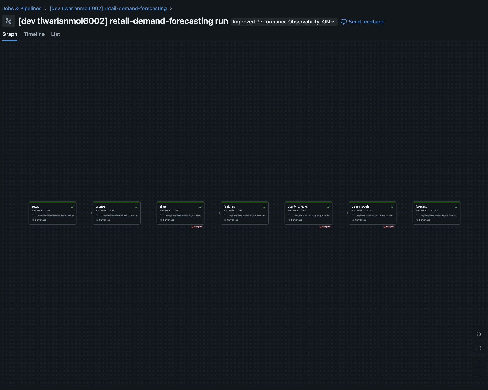
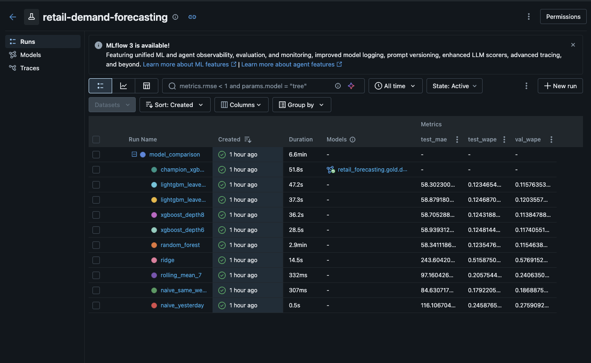
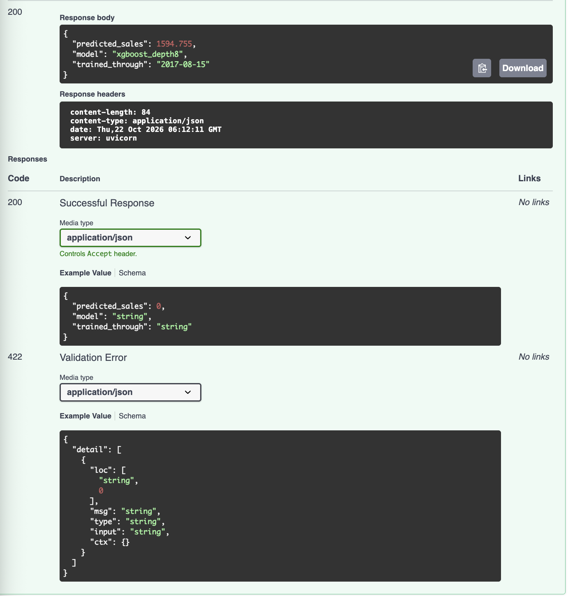

# Retail Demand Forecasting & ML Experiment Platform

An end-to-end demand forecasting project: multi-source retail data → **Databricks** (PySpark, Delta Lake, Bronze/Silver/Gold) → leakage-safe **feature engineering** → baseline and ML models compared with **MLflow** → **champion model** registered in Unity Catalog → **7-day recursive forecasts** → served through a **FastAPI** service (Docker). Raw data is archived in **AWS S3**.

Data: Kaggle [Store Sales – Time Series Forecasting](https://www.kaggle.com/competitions/store-sales-time-series-forecasting) (Corporación Favorita, Ecuador): 54 stores × 33 product families, daily sales 2013-01-01 → 2017-08-15, plus stores, oil prices, holidays/events, store transactions and the competition's `test.csv` (promotions for the next 16 days).

```
Kaggle CSVs ──► S3 (raw archive)
      │
      └──► Databricks volume ──► BRONZE (raw + lineage)
                                    ──► SILVER (typed, joined: stores, transactions, oil, per-store holiday calendar)
                                          ──► GOLD demand_features (lags, rolling stats, calendar, lagged covariates)
                                                ──► quality gate (fails the job on violations)
                                                      ──► train + compare (MLflow) ──► champion (Unity Catalog, alias "champion")
                                                            ──► 7-day recursive forecast ──► gold.demand_forecasts
                                                                  ──► FastAPI /predict, /forecasts  (Docker, optional EC2)
```

## What makes it more than a notebook

| Decision | Why |
|---|---|
| **One row = (store, family, day d)**; target is sales on day d | Everything used as an input is known *before* d, so there is no accidental use of the answer. |
| Sales features use only data up to **d-1** (`lag_1/7/14/28`, rolling mean/std shifted by one day) | Classic leakage guard; unit tests change today's sales and assert today's features do not move. |
| **Past covariates are lagged by the forecast horizon** (`transactions_lag_7`, `transactions_roll_mean_28`, `oil_price_lag_7`) | Same-day transactions are not known in advance. A 7-day lag makes the feature identical in training and in inference for every horizon day. |
| Known-in-advance inputs for day d: promotions, holiday calendar, calendar features | Promotions for the horizon come from Kaggle's `test.csv`, holidays from `holidays_events.csv`. |
| Correct **holiday logic**: `transferred` rows are normal days, `Transfer` rows are the real holiday, National / Regional (state) / Local (city) matched per store | Naive "is the date in the holiday file" joins are wrong for this dataset. |
| **Calendar-day windows** (missing days such as 25 Dec are gaps, not shifted rows) | `lag_7` always means exactly 7 days. |
| **Spark and pandas implementations of the features + a parity test** | Training (Spark, batch) and recursive inference (pandas) cannot drift apart: `tests/test_spark_parity.py` asserts identical numbers. |
| **Chronological** train / validation / test split (last 31 days = test, 45 days before = validation) | No shuffling. Model selection uses **validation WAPE only**; test is reported, never used to choose. |
| **Baselines first** (yesterday, same weekday last week, 7-day mean) | An ML model is only useful if it beats these. |
| `log1p` target transform, models wrapped in one sklearn `Pipeline` | Skewed demand; preprocessing travels with the model so serving cannot mismatch. |
| Champion **refit on all history** before registration | Final model sees the most recent data. |
| Error analysis by family, store, holiday / promo / normal days, worst misses | Shows *where* the model fails, not just one score. |
| Data-quality gate with leakage checks (`lag_1` must equal yesterday's sales) | The job fails before training if data or features are wrong. |

## Repository layout

```
src/demand/            config, features (pandas), spark_etl (PySpark), store_calendar, etl, models, training,
                       analysis, forecast, metrics, baselines, synthetic, pipeline (local runner)
src/ingestion/         download_data.py   (synthetic | zip | kaggle)
src/api/main.py        FastAPI service
databricks/            00_setup … 06_forecast notebooks (thin wrappers around src/demand)
resources/             Databricks job definition (7 tasks)     databricks.yml  bundle config
sql/                   00_setup.sql, analytics.sql (exploration, model-result and forecast queries)
scripts/               S3 sync, upload to Databricks volume, export model for the API
tests/                 unit tests (features, calendar, metrics, training, MLflow, forecast, API, Spark parity)
Dockerfile             API image       .github/workflows/  CI + manual Databricks deploy
```

## 1. Run it locally in 2 minutes (synthetic demo data, no accounts needed)

```bash
python3 -m venv .venv && source .venv/bin/activate
pip install -r requirements-dev.txt
pytest -q                                   # all tests (Spark parity tests need Java 17; on macOS XGBoost also needs `brew install libomp`)
make demo                                   # synthetic data -> features -> train -> compare -> forecast
mlflow ui --backend-store-uri sqlite:///mlflow.db     # open http://127.0.0.1:5000 to compare runs
make api                                    # http://127.0.0.1:8000/docs
```

Outputs: `outputs/model_comparison.csv`, `error_by_*.csv`, `feature_importance.csv`, `models/demand_model.joblib`, `models/forecasts.csv`.
The synthetic data only proves the pipeline works; **do not quote its numbers**.

## 2. Use the real Kaggle data

1. Join the competition on Kaggle (accept the rules) and download `store-sales-time-series-forecasting.zip`.
2. `python src/ingestion/download_data.py --source zip --zip ~/Downloads/store-sales-time-series-forecasting.zip`
   (or `--source kaggle` if the Kaggle CLI is configured). You need all six files in `data/raw/`.
3. Optional local run on the real data: `PYTHONPATH=src python -m demand.pipeline --train-start 2016-01-01`
4. Archive in S3: `BUCKET=<your-bucket> ./scripts/sync_to_s3.sh`

## 3. Run it on Databricks

1. In the Databricks SQL editor run `sql/00_setup.sql` (creates the catalog, schemas and the two volumes).
2. Deploy and upload the data:

```bash
databricks auth login --host https://<your-workspace>.cloud.databricks.com
./scripts/upload_raw_to_databricks.sh                   # copies the six CSVs into the raw_data volume
databricks bundle validate -t dev && databricks bundle deploy -t dev
databricks bundle run demand_forecasting_job -t dev     # setup → bronze → silver → features → quality → train → forecast
```

Tasks: `setup → bronze → silver → features → quality_checks → train_models → forecast`. Results land in `retail_forecasting.gold.*` (`model_comparison`, `forecast_evaluation`, `error_by_*`, `worst_errors`, `feature_importance`, `demand_forecasts`). Run `sql/analytics.sql` for the analysis queries.

Free Edition notes: serverless only, restricted outbound internet (hence the manual upload) and limited compute quotas. If training is too slow, raise `train_start` (e.g. `2017-01-01`) in `databricks.yml` or lower `rf_max_rows`.

## 4. Serve the model

```bash
./scripts/export_artifacts.sh            # downloads demand_model.joblib / .json / forecasts.csv from the Databricks volume
uvicorn src.api.main:app --reload        # GET /health, POST /predict, GET /forecasts?store_nbr=1&family=BEVERAGES
docker build -t retail-demand-api .
docker run -p 8000:8000 -v "$PWD/models:/app/models" retail-demand-api
```

Use the **same scikit-learn / xgboost / lightgbm versions** locally as on Databricks (printed in `models/demand_model.json`); a pickle trained with other versions can fail or warn. Alternatively set `MODEL_URI=models:/retail_forecasting.gold.demand_forecaster@champion` with `DATABRICKS_HOST` / `DATABRICKS_TOKEN` to load from the registry (needs `mlflow`).

Optional AWS deployment: run the Docker image on a small EC2 instance and `docker run` it there. Check the current AWS free-tier / credit terms first and stop the instance when you are not using it.

## 5. Results (full Databricks run on the Kaggle Store Sales data)

Chronological split: train up to 2017-05-31, validation 2017-06-01 to 2017-07-15 (used to select the model), test 2017-07-16 to 2017-08-15 (final hold-out, never used to choose a model). Training window starts 2016-01-01.

| Model | Val WAPE | Test WAPE | Test MAE | Test RMSE |
|---|---|---|---|---|
| Naive (yesterday) | 0.2759 | 0.2459 | 116.11 | 399.97 |
| Same weekday last week | 0.1869 | 0.1792 | 84.63 | 310.16 |
| 7-day rolling mean | 0.2406 | 0.2058 | 97.16 | 335.01 |
| Ridge | 0.5769 | 0.5159 | 243.60 | 1704.36 |
| Random Forest (300k-row sample) | 0.1155 | 0.1235 | 58.34 | 209.24 |
| XGBoost (depth 6) | 0.1174 | 0.1248 | 58.94 | 210.33 |
| **XGBoost (depth 8) - champion** | **0.1138** | **0.1243** | **58.71** | **211.33** |
| LightGBM (31 leaves) | 0.1204 | 0.1247 | 58.88 | 207.31 |
| LightGBM (63 leaves) | 0.1158 | 0.1235 | 58.30 | 206.72 |

**Findings**
* The champion (chosen on validation WAPE) has a test WAPE about **31% lower** than the best baseline (0.1243 vs 0.1792).
* The tree-based models perform almost identically; random forest and LightGBM are marginally ahead on test (0.1235), a difference within noise.
* Ridge fails (WAPE 0.58): a linear model on raw, heavily skewed lag features produces a few very large misses. Log-scaling the lag features would be the fix.
* **Where it fails (test block):** the sparsest families (BOOKS, HOME APPLIANCES, BABY CARE) have the highest WAPE (1.25-2.62) but sell only 29-413 units in the month, so the percentage error comes from tiny denominators. The most costly weak spot by volume is SCHOOL AND OFFICE SUPPLIES (WAPE 0.45 on about 57,800 units, MAE 15.5), most likely seasonal (not verified).
* Holiday rows are slightly harder (WAPE 0.156) than normal days (0.143) and promotion days (0.121); the holiday group is small (2,409 rows).

## Pipeline run
Successful Databricks job run (setup -> bronze -> silver -> features -> quality checks -> train models -> forecast):



## Experiment tracking
All runs are tracked in MLflow on Databricks. The champion (refit on all history) is registered in Unity Catalog:



## API
The champion model is served with FastAPI. Example `POST /predict` call (illustrative input values; the real 7-day forecasts are in `forecasts.csv`):



## Limitations (be upfront about these)

* The dataset ends on 2017-08-15; the "next 7 days" are the 7 days after the last observed date, and Kaggle's true values for them are not public, so those forecasts cannot be scored. Accuracy is reported on the held-out last 31 days.
* Recursive forecasting accumulates error with the horizon, so accuracy is expected to degrade from day 1 to day 7.
* Store-level aggregates only (no item-level data, no prices, no stock-outs); zero-inflated families are hard to forecast.
* Free Edition cannot read S3 directly, so the CSVs are uploaded to a Databricks volume and S3 is the raw archive.
* Possible extensions: rolling-origin cross-validation, quantile forecasts / prediction intervals, drift monitoring, a dashboard.
